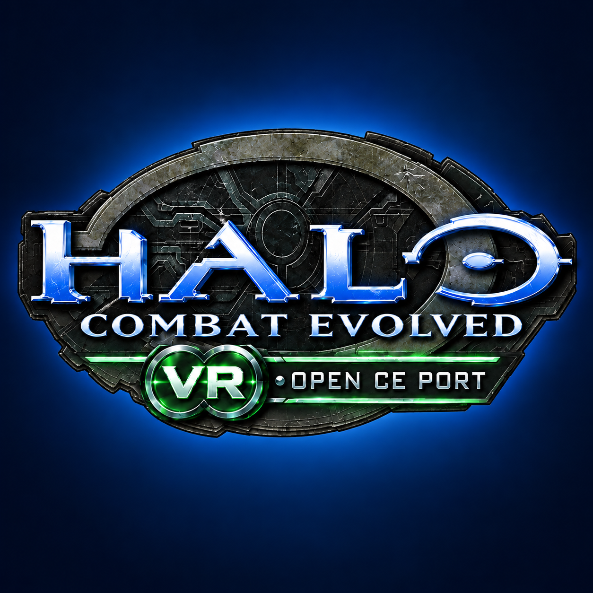

<h1 align="center">Halo CE Quest VR + Android</h1>

An unofficial OpenCE-based community port for standalone Meta Quest VR and flat Android.

**Latest: [1.0.37 — Test70](https://github.com/moistman42069/HaloCE-Quest-VR/releases/tag/v1.0.37).** This is a large cumulative update. Read the release notes, especially the experimental-feature and compatibility sections, before enabling optional systems.

> **Experimental / WIP:** fist combat and projectile deflection, sliding, parkour, physical reload, ragdolls and body interactions, immersive vehicle controls, and broad support for user-supplied mods still need refinement and device reports. Enable experimental options one at a time. Project Lumoria and SPV1 have specific setup paths; this does not mean every mod works. MCC maps and The Altheros Experience remain experimental.

## Download and update

| Device | Download |
| --- | --- |
| Android phone/tablet — flat | [HaloCE-Android-1.0.37.apk](https://github.com/moistman42069/HaloCE-Quest-VR/releases/download/v1.0.37/HaloCE-Android-1.0.37.apk) |
| Meta Quest — standalone VR | [HaloCE-Quest-1.0.37.apk](https://github.com/moistman42069/HaloCE-Quest-VR/releases/download/v1.0.37/HaloCE-Quest-1.0.37.apk) |

Both builds require ARM64 and Android 9 / API 28 or newer. On Quest, enable Developer Mode and sideload with SideQuest or ADB. On Android, allow installation from the browser/file manager when prompted.

Existing users can use the launcher's project updater or install the matching APK over the current app. **Do not uninstall or clear app data** if you want to keep saves, settings and imported files. The public release is v1.0.37; the APK reports its exact build identity as **1.0.37-test70 / code 82**. Package IDs and signing certificate are unchanged. `compatibility.json` is required by the updater and is already handled by it; do not install it manually.

The app contains no Halo game data. Import your own complete supported Xbox Halo CE ISO/XISO or extracted game files through **Game files & versions**. The original Xbox XISO remains the recommended reference.

## What changed

- **Launcher and campaigns:** What's New appears after an update and can be reopened; campaign buttons show their support status. Project Lumoria has a guided import/install/restore flow for a player-supplied archive or folder. The MCC damaged-disc lookup was repaired, but MCC maps remain experimental pending headset confirmation. Altheros script support improved in Test69; later level loading still needs device logs.
- **Controls:** button remapping now asks before changing a binding, offers CANCEL / SWAP / CLEAR / BOTH, supports NONE, shows contextual ownership, and has RESET CONTROLS at both ends of the page. MIRROR BUTTONS puts face-button actions on the gun hand for left-handed play without rewriting saved bindings.
- **Weapons:** locked weapons can be holstered; the Needler supports deliberate shake reload when manual reload is enabled; optional shake cooling responds to deliberate strokes; empty rocket tubes and the flamethrower canister are ready when seated; charging feedback and Pistol/AR magazine fit were refined. Left-hand weapon lettering and button ownership were improved.
- **Movement and combat:** optional SLIDE, solo-only BULLET TIME, improved tree contact and look-directed wall jumps, fist HIT ASSIST and LUNGE HOP, and a larger GRAB ASSIST default. Sliding, fist combat, deflection and parkour remain experimental and can feel inconsistent.
- **Graphics and bodies:** Extra Effects includes optional overshield visuals, dynamic/vehicle blood, projectile effects, stencil shadows and Jolt-backed dropped-weapon physics. Corpse duration/limits and other visual options are configurable. Dynamic death ragdolls use Jolt; the VR ragdoll range default is increased. See the release notes for performance and multiplayer limits.
- **Android:** existing touch controls and controller support remain, including touch-layout export/import, hiding selected HUD controls, optional touch looking and controller-aware touch visibility.
- **Android third person:** the optional over-the-shoulder camera works on foot in campaign and co-op. Turn it on under **Settings → Video Setup → FOV and Viewmodels → Third Person**; it starts off. Keyboard users can toggle it with Keypad Enter and use Alt to look around. This is separate from VR vehicle view settings.
- **Multiplayer:** OpenCE Build 206 / network 29 is retained. The app hosts on 29 and can target compatible hosts 11–29. Native in-game browser, PvP/campaign hosting, voice chat and launcher population lists remain. Voice transmission depends on host settings and microphone permission.

## Controls, setup and compatibility

The [complete 1.0.37 release notes](docs/RELEASE-1.0.37.md) include installation, Quest and Android inputs, all new settings, server setup, game revisions, WIP notes, testing status and credits. The [Test70 field guide](docs/TEST70-FIELD-GUIDE.md) provides the full menu and feature reference; [controls and options](docs/CONTROLS-AND-OPTIONS.md) and the [Android touch guide](docs/ANDROID-TOUCH-CONTROLS.md) give further detail.

For VR, the familiar defaults remain **Legs + Arms**, **Safe geometry**, **Third Person vehicles** and **Right Hand steering**. Experimental systems are optional and may be restricted in multiplayer/co-op unless the host and peers support and allow them. For Android gamepads, use **Controller & touch settings** to adjust mapping, dead zones, sensitivity and touch visibility.

The tested USA Original, Rev 1 and Rev 2 images contain identical copies of their 24 maps; other regions, repacks and modified images are not certified. Custom Edition and campaign co-op have additional network-version and content requirements. The release notes explain these limits.

## Support and project

Please report both failures and successful tests, especially for fist combat/deflection, sliding, ragdolls, campaigns, vehicle options, and co-op. Include device and OS, app and network version, selected game-data set, map/mission, relevant settings, steps to reproduce, and the log of the run it happened in (where each device keeps it, below). For co-op, logs from both players help. Remove private invites/device details before public posting.

| Device | Each run's log |
| --- | --- |
| Quest, PICO, Android | **Download/HaloCE**: `halo_log_<date>_<time>.txt`, the newest the last run, the last ten kept (the game's own `debug.txt` lines are in it). A copy of the last run's: `Android/data/<package>/files/halo_log.txt`. |
| Steam Frame | **Documents/HaloCEQuestVR/logs** (Desktop Mode's file manager): `halo_log_<date>_<time>.txt`, the last ten kept. Beside that folder: `launcher.log` (each start from Steam), `logcat.txt` (the last run's Android log), `install.log` (the installer's). |
| Windows | Beside the game: `halo.log` (`halo.exe`) and `halo-vr.log` (`halo-vr.exe`, PC VR), the last run's; the ten runs before each in **logs** (`halo_<date>_<time>.log`, `halo-vr_<date>_<time>.log`). The game's own `debug.txt` is in the game data folder. The PC launcher's **LOGS** page opens these folders. |

Contact **@MeWhenINameMyself** by Discord DM, use the [Halo CE Decomp Discord](https://discord.gg/S9uSCKxKx), or report in the [Flat2VR Halo CE discussion](https://discord.com/channels/747967102895390741/1555959498349215774). This build is intended to collect real-device feedback for the next refinement pass.

The About description is unchanged. This repository is an unofficial community project, not affiliated with Microsoft. No Halo game files are distributed. See [credits](CREDITS.md) and [third-party notices](THIRD-PARTY-NOTICES.txt). PC and Steam Frame ports remain deferred.

## Licence

From Test73 on, this project is free software under the terms of the GNU Affero General Public License, version 3 or (at your option) any later version (`AGPL-3.0-or-later`), without any warranty; the full text is in [LICENSE](LICENSE).

- **Why:** this port merges OpenCE, which moved to the AGPL 3.0 or later with its commit 4b09168e7 (between its Builds 232 and 246), as the decompilation both build on did ([punpckhdq/halo](https://github.com/punpckhdq/halo), from 17 October 2026).
- **Before the change:** the code from before it, and every release of this project up to Test72 (v1.0.37 included), were released under [CC0 1.0](LICENSES/CC0-1.0.txt) and stay that way.
- **Source:** each release's source is offered with it (the release's source zip, and its tag).
- **Hosts and servers:** if you change the game and let other people play your version over a network (as an internet game's host, for example), the AGPL asks you to offer them your version's source (section 13).
- **Other parts:** third-party code, fonts and art keep their own licences, next to them and in [THIRD-PARTY-NOTICES.txt](THIRD-PARTY-NOTICES.txt).
- **Halo is not covered:** the licence covers this project's and its upstreams' work, and gives no rights in Halo, its maps or anything else Microsoft owns.
